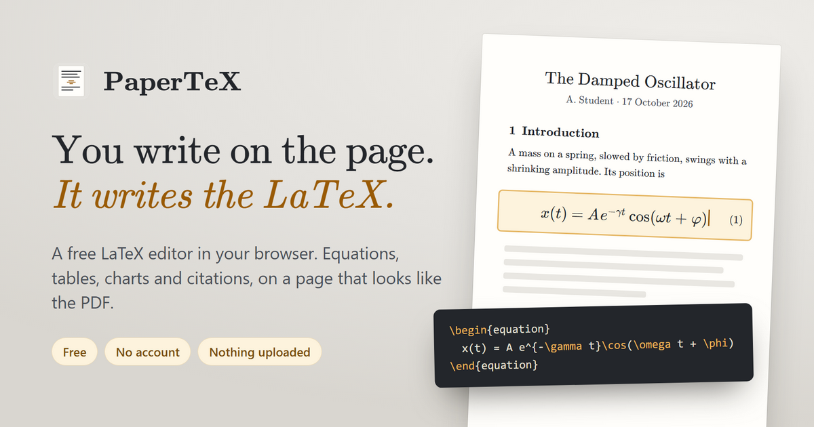

# PaperTeX

**You write on the page. It writes the LaTeX.**



A LaTeX editor with no LaTeX in it. You write on a page that looks like the
finished PDF — headings, equations, figures, tables, charts, citations — and
the `.tex` source is generated from what you did. The document model is the
truth; LaTeX is the output. If you do know LaTeX, the pane beside the page is
editable, and a `.tex` file or a whole Overleaf project opens back into a page
you can edit.

It runs entirely in the browser. There is no account and no server: documents
stay in the browser's storage, and the PDF is typeset by TeX Live compiled to
WebAssembly, on your own machine.

**Use it:** <https://ayz345.github.io/papertex/> — nothing to install.

## Run it from this repository

Node or Python is enough; there is nothing to install first.

```bash
git clone https://github.com/Ayz345/papertex.git
cd papertex
python -m http.server 8777
```

Then open <http://localhost:8777/> for the home page, or
<http://localhost:8777/app.html> for the editor. On Windows, double-clicking
**`start-papertex.cmd`** does the same and opens the single-file build,
`papertex.html`.

The folder has to be served. Opening `papertex.html` straight off disk works
for writing, exporting and printing, but **not for Make PDF**: the compiler
runs in a Web Worker, and no browser starts one on a `file://` page.

**Make PDF in a clone** fetches the engine (a 29 MB wasm file and the TeX Live
bundles a document needs) from `cdn.siglum.org` the first time, and the
browser caches it. To compile with no network, download TeX Live once into
`engine/texlive/` (about 220 MB, not kept in this repository); the editor
finds it there and uses it instead:

```bash
npm run fetch-texlive
```

## Build and check

None of these needs `npm install`:

| command | what it does |
|---|---|
| `node build.js` | regenerates `papertex.html`, the editor as one self-contained file |
| `npm run build:web` | assembles the website in `dist/web/` — see [DEPLOY.md](DEPLOY.md) |
| `npm run check:texread` | reads PaperTeX's own LaTeX, a hand-written paper and an Overleaf project back in, and compares |
| `npm run check:dist` | fails if `dist/web/` is older than its sources |
| `npm run check:launch` | fails if `dist/web/` is not fit to go live |

`npm install` is only for rebuilding the engine bundle (`npm run build:engine`,
esbuild), redrawing the link-preview picture (`npm run og-image`) and the
desktop shell below; the last two bring in Electron.

`http://localhost:8777/tools/mathcheck.html` sets a list of formulas with
PaperTeX beside KaTeX, in display and inline style; in its console,
`compare('display')` and `compare('inline')` list every glyph whose position
differs from KaTeX's by more than a few hundredths of an em. Run it after
touching the math layout in `js/math.js`.

[.github/workflows/pages.yml](.github/workflows/pages.yml) publishes the site
to GitHub Pages on every push to `main`: it runs the checks, downloads TeX
Live, builds with `--with-texlive` and uploads `dist/web/`.

### Desktop shell

`desktop/` holds an Electron shell from before PaperTeX became a website
(`npm install`, then `npm run desktop`). It is not maintained or tested any
more. The folder also holds the icon the site uses.

## How it was built

PaperTeX is Ayaz Büyükterzi's project: the idea, what it does and how it
should feel to use. The code was co-authored with Claude, Anthropic's AI
coding assistant, and the commit history says so on each commit.

First-time use was tested in five rounds with AI agents standing in for new
users, each given a writing task and no information about the editor. The
method, the scores and everything that went wrong are in
[usability-test-2026-10-04/](usability-test-2026-10-04/REPORT.md). Those
testers are not people; a round with human users has not been done yet.

## Pages and files

The site has three pages: `index.html` (home), `app.html` (the editor) and
`about.html`. The home page reads saved documents and templates through
`js/home.js` and links into the editor with `app.html#new=<template>` and
`app.html#doc=<id>`.

## How it works

| | |
|---|---|
| `js/math.js` | The formula engine: a tree model, a WYSIWYG renderer with its own caret and keyboard handling, LaTeX serialisation, and a small LaTeX parser used only for pasting. |
| `js/doc.js` | The document model (blocks) and the on-paper editor — numbering, block menus, inline formulas, tables, figures, lists. |
| `js/latex.js` | Turns the model into a `.tex` file, collecting the packages it actually needs. |
| `js/chart.js` | Function plots, charts of data, histograms, pies, polar plots and 3D surfaces: a formula parser (no `eval`), the SVG drawn on the page, and the pgfplots code for the `.tex`. Axis limits, ticks and the legend corner are decided here and written into both, so the PDF matches the page. |
| `js/texread.js` | The other way round from `latex.js`: reads a `.tex` file back into a document. What PaperTeX wrote comes back as the blocks it was written from. `js/unzip.js` opens an Overleaf project's `.zip` for it. |
| `js/studio.js` | The chart and table editor: a chart or table opened to fill the window, with every setting beside it. |
| `js/compile.js` | Make PDF: loads the engine only when a PDF is asked for, and hands it the source, the figures and the packages the document uses. |
| `js/store.js` | Where documents live between sessions: IndexedDB, several documents, saves that are checked. |
| `js/sanitize.js` | The gate stored rich text passes through, so HTML from a project file never reaches the page as it is. |
| `js/keys.js`, `js/palette.js` | One registry of everything a key can do, and the `Ctrl+K` command palette that searches it. |
| `js/templates.js` | The starting documents under **New**. |
| `js/home.js` | What the home page needs without loading the editor: recent documents and templates. |
| `js/symbols.js` | Symbol and structure tables driving the palette and the `\command` autocomplete. |
| `js/app.js` | Chrome: palettes, LaTeX pane, outline, settings, undo, storage, export. |

Formulas are never stored as strings. Every equation is a tree of nodes
(`frac`, `scr`, `sqrt`, `big`, `paren`, `mat`, …), which is what the caret moves
through and what gets serialised. That is why `↑`/`↓` step between numerator and
denominator, and why `Backspace` at the front of a denominator dissolves the
fraction instead of deleting a brace.

## Writing

- `Ctrl+K` — the command palette: one search over every block, symbol, structure,
  template and command, showing each one's shortcut; `\` in running text opens it at
  the caret (`\` twice types a backslash)
- **New** — start blank or from a template: article, homework, lab report, data report, chart gallery, lecture notes
- `/` on an empty line — block menu (section, equation, figure, table, function plot, chart, histogram, pie, polar plot, 3D surface, list, theorem, code, bibliography, raw LaTeX)
- **Function plot** — type `y = 2x^2 - 3x + 1`, `sin x`, `e^(-x/2)`, `|x|` the way they are written
  on paper; several curves, ranges such as `-2pi` to `2pi`, axes framed or through the origin
- **Chart** — line, scatter or bar chart of a table in the document (it follows the
  table as you edit it) or of rows pasted from a spreadsheet; curves such as a fitted
  model can be drawn over the data. Exported as pgfplots
- **More charts** — horizontal bars; histograms (bins worked out on the page, with an
  optional normal curve); pie and ring charts (plain TikZ); polar plots `r = cos(3θ)`
  (pgfplots `polaraxis`); 3D surfaces `z = sin(x) cos(y)` (`\addplot3[surf]`, any view
  angle, colour maps, a colour bar); logarithmic x and y axes; areas shaded under a
  curve or between two (`\closedcycle`, `fill between`). The **Chart gallery** template
  has one of each
- **Tables** — paste a block of cells from Excel or Sheets into a cell; rows and
  columns go in beside the cell you are in; the 📊 button charts the table
- **The chart and table editor** — a new chart or table opens full-window, and so does
  clicking a chart (or a table's ⤢ button): the drawing large, its data as a
  spreadsheet, every setting beside it. Charts: type, series colours, line styles,
  points, smooth lines, error bars, stacked bars and value labels, curves over the
  data, title, axis ranges and tick spacing, framed or arrow axes, grid, legend place,
  width and shape. Tables: book rules, grid or plain; bold header or first column;
  shaded rows; text size; caption above or below; sort, swap rows and columns,
  totals/average/min-max rows, CSV import and copy. Every change shows on the page
  and in the LaTeX at once; *Undo changes* restores it as it was when it opened
- `$` mid-sentence — inline formula, editable again by clicking it
- `Ctrl+Enter` — display equation below the current block
- Select text — bold, italic, code, cross-reference, or *make this a formula*

- Paste or drag an image anywhere — it becomes a figure with a unique file name

### Inside a formula, type the name of what you want

`int` becomes an integral with the caret waiting in its lower limit; `sum`,
`prod`, `lim`, `sqrt`, `frac`, `matrix`, `cases`, `vec`, `hat` likewise.
`alpha` becomes α, `inf` becomes ∞, `partial` ∂, `in` ∈. `sin` becomes an
upright function name. `->` `<=` `>=` `!=` `+-` become → ≤ ≥ ≠ ±.

A word converts as soon as it can no longer grow into a longer one — `sum`
fires immediately, `sin` waits for the next keystroke because `sinh` exists.
**Backspace straight afterwards puts the letters back**, so `p·i` is still
reachable when you did not mean π. The whole behaviour can be switched off
under Document → Formulas.

A digit straight after a letter becomes an index — `x1` gives x₁, `a12` gives
a₁₂, `alpha3` gives α₃ — except inside a subscript, where `x_n` followed by `1`
stays `x_{n1}`. The caret goes into such an index so you can see where the
next digit lands, but only digits continue it: anything else steps back out
first, so `x1+x2` and `x1, x2` need no extra keys, and `x1^2` gives x₁².
`ü` is a second superscript key, for layouts where `^` is a dead key needing
two presses; the dead key itself is understood too.

### Moving around a formula

`Enter` (or `Space`) means *done with this part*: it moves to the next part of
whatever you are in, and after the last one, out behind it. So `int`, `0`,
`Enter`, `1`, `Enter` leaves you writing the integrand of ∫₀¹; in a fraction it
goes numerator → denominator → after the fraction; in an exponent it steps
back down to the line. An operator whose lower limit you leave empty is taken
to want no limits, and `Enter` skips straight past them. Only on the line
itself does `Enter` start a new equation line — and on an empty last line it
ends the equation and returns to the text.

`↑` and `↓` go to what is drawn above or below the caret. On the line, `↑`
enters the exponent, upper limit or numerator next to the caret and `↓` the
index, lower limit or denominator; inside, they move between the two parts,
and from an exponent `↓` comes back to the line. The caret keeps its place
across the page. `Tab` steps through every slot strictly in order, empty ones
included (`Shift+Tab` back), and `^` / `_` still jump between the limits.

The rest: `/` fraction · `^` `_` scripts · `(` `[` `|` auto-growing delimiters ·
`\name` the long way round · `Esc` returns to the text.

## Keyboard shortcuts

Every command, block type and palette symbol can have keys of your own, and so
can any LaTeX snippet — `\mathbb{R}`, `\frac{d}{dx}`, `\int_{0}^{\infty}` —
under **? Shortcuts → customize** or **Document → Keyboard**. An empty `{}` in
a snippet is a slot the caret lands in. Shortcuts are kept in local storage,
separately from the document, so they survive restarts; the desktop menu
shows whichever keys are current.

## Typeface

The page sets in real Computer Modern — the faces are embedded in the file, so
the preview matches what `article` will compile to rather than approximating it
with Times. They come from KaTeX (MIT, see `fonts/LICENSE-KaTeX.txt`). KaTeX
stops at English, so letters such as ç ğ ş ö ü é, Greek in text, and more
punctuation come from CMU Serif, the same design (SIL OFL, see
`fonts/LICENSE-CMU.txt`), cut to exactly the characters KaTeX lacks by
`tools/subset-cmu.py`. `node tools/genfonts.js` regenerates `css/fonts.css`
from `fonts/`.

## LaTeX in

**Open** takes a `.tex` file, or an Overleaf project — its `.zip`, or the
`.tex` with its `.bib` and images — and turns it into a page you can edit.
LaTeX pasted onto the page is read the same way. The LaTeX pane beside the
page is editable too: type LaTeX there and the page follows when you pause.
LaTeX that PaperTeX cannot turn into a block is kept as a LaTeX-code block.

## Output

**Download .tex** writes the source; if the document has figures, the image
files are downloaded alongside it — keep them in the same folder as the `.tex`
so `\includegraphics` resolves. **Quick print** prints the page as shown, which
is useful for a quick look but is *not* a LaTeX-typeset PDF.

**Make PDF** typesets the document with real LaTeX — TeX Live 2025 built to
WebAssembly ([@siglum/engine](https://github.com/SiglumProject/siglum-engine),
MIT) — running in your browser. Nothing is uploaded: the engine is fetched as
static files and cached. The first PDF takes ten seconds or more while the
engine downloads; later ones skip the download. The result opens in a viewer
with **Save PDF**.

Figures are handed to the compiler alongside the source, so `\includegraphics`
resolves. See [engine/README.md](engine/README.md) for the packages the engine
has, and [DEPLOY.md](DEPLOY.md) for serving TeX Live from your own site — which
a published copy must do.

**Save** stores the project as a file so you can keep editing later; the
current document also autosaves to the browser. Browser storage can be cleared,
and Safari deletes it after seven days without a visit, so **Save** is the copy
that lasts.

### Running inside a sandboxed viewer

Published as an Artifact, the page is sandboxed, and two things the browser
normally allows are withheld: it may only save a short list of file extensions
(`.tex` is not among them, so the source arrives as `.tex.txt` — delete the
suffix), and it cannot open a print dialog. Print falls back to opening, or
handing over, a self-contained printable copy that prints itself.

`papertex.html` opened from your own disk has neither limitation: real `.tex`
downloads and a normal print dialog.

## Limits worth knowing

- The on-screen page approximates LaTeX's layout — it is a faithful preview of
  structure, not of line breaking or float placement.
- Page-break guides are drawn at page height; real pagination happens in LaTeX.
- Pasting LaTeX into a formula understands the common constructs, not the whole
  language. Anything unrecognised is kept verbatim, and the *Raw LaTeX* block is
  there as a deliberate escape hatch.
- On a phone you can read a document and make small edits; writing one needs
  a keyboard.

## Licence

MIT — see [LICENSE](LICENSE). Fonts, the LaTeX engine and the TeX Live packages
keep their own licences, listed in
[THIRD-PARTY-NOTICES.md](THIRD-PARTY-NOTICES.md).
